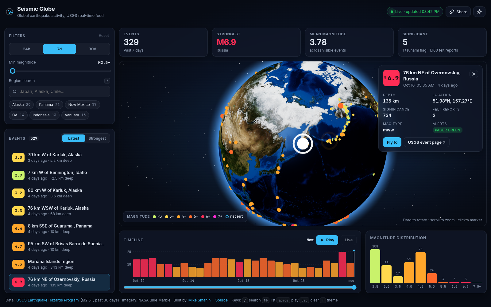
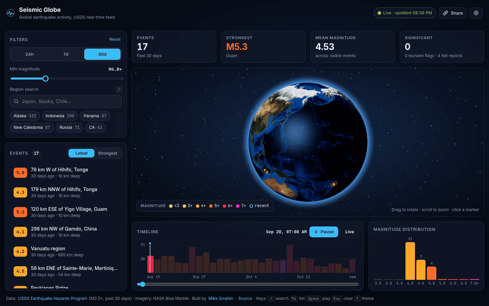
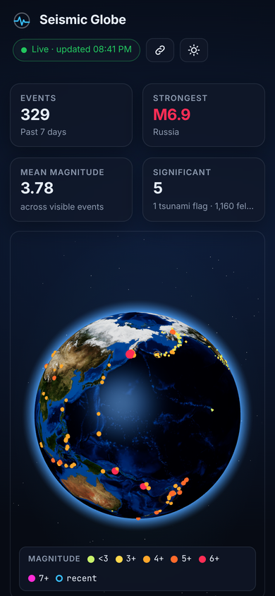

# Seismic Globe: live earthquake dashboard

An interactive data dashboard built around a 3D globe. It streams the **USGS real-time earthquake feed** and lets you filter, scrub through time, and inspect events. Every panel (globe, list, KPIs, charts) stays in sync, and the whole view is shareable via the URL.

**Live demo: https://iodiot.github.io/globe-dashboard/**



<p>
  
  
</p>

<sub>Screenshots and GIF are real captures of the app with live USGS data, recorded in headless Chrome with software (SwiftShader) WebGL. The GIF is sped up because software rendering captures only a few frames per second.</sub>

## Features

- **Live data, honest fallback.** On load the app fetches the USGS M2.5+ 30-day GeoJSON feed (no API key, CORS-enabled), then refreshes every 5 minutes from the small 24-hour feed and merges by event id. If the feed can't be reached, a bundled snapshot loads instead, with a **Snapshot** badge and a banner in the UI.
- **Realistic globe** (Three.js via React Three Fiber): NASA Blue Marble texture, bump map, ocean specular map, Fresnel atmosphere shader (additive on dark, alpha-blended on light), and a star field.
- **Instanced markers.** All events render in one draw call (`InstancedMesh`), sized and coloured by magnitude. **Recent events pulse**, with the ring animation running entirely in a vertex shader, so there's no per-frame CPU work.
- **Hover tooltip, then click to select.** Selecting an event flies the camera there along a quaternion slerp with easing. Markers on the far side are occluded for picking.
- **Sidebar list synced with the globe.** It's virtualised (`@tanstack/react-virtual`), sortable by latest or strongest, and auto-scrolls to the selection.
- **Filters:** time range (24 h / 7 d / 30 d), magnitude slider, and region search (debounced, with suggestions and chips for the most active regions).
- **KPI cards:** count, strongest event (click to select it), mean magnitude, and significant events with tsunami flags and felt reports.
- **Charts** built as hand-written SVG React components, no chart library:
  - an events-over-time histogram that doubles as a **timeline scrubber** (drag on it);
  - a magnitude distribution where clicking a bar sets the minimum magnitude.
- **Timeline playback.** Replays the selected window in 20 s. The globe, list, KPIs and magnitude chart only show events up to the cursor.
- **URL state.** Filters, sort and selection live in the query string (`?range=30d&mag=4.5&q=Japan&sel=us6000…`). The **Share** button copies the link.
- **Dark / light theme.** Follows the system setting by default, and your choice is saved in localStorage.
- **Responsive layout**, from a desktop three-pane view down to a single column on phones.
- **Keyboard accessible.** The event list is an ARIA listbox (↑ ↓ Home End PgUp PgDn), with visible focus rings and a skip link. Shortcuts: `/` search, `Space` play/pause, `Esc` clear selection, `T` theme. `prefers-reduced-motion` turns off auto-rotate, pulses and camera flights.

## Tech stack

React 19 · TypeScript (strict) · Vite · Three.js · @react-three/fiber + drei · zustand · @tanstack/react-virtual · Vitest

## Architecture

```
src/
  data/            pure, framework-free and unit-tested
    types.ts         Quake, Filters, dataset types
    usgs.ts          fetch + parse/normalise the USGS GeoJSON, merge, snapshot fallback
    filters.ts       filtering, sorting, KPIs, time + magnitude histograms, colour/size scales
  state/
    store.ts         zustand store: dataset, filters, selection, hover, playback cursor, theme
    selectors.ts     memoised derived data (filtered → visible → sorted / KPIs / histograms)
    urlState.ts      validated query-string (de)serialisation
  hooks/           data loading + refresh, URL sync, playback loop, shortcuts, theme
  components/
    globe/           R3F scene: Earth, Atmosphere, Markers, Pulses, SelectionRing, CameraRig
    *.tsx            Header, FiltersPanel, QuakeList, KpiCards, TimelinePanel, MagnitudeChart, DetailCard, Tooltip
```

- **One source of truth.** Components subscribe to small slices of the zustand store. Derived data comes from selectors memoised on input identity (`memoLast`, like reselect), so a dataset is filtered once per change no matter how many components read it, and zustand only re-renders consumers whose slice actually changed.
- **Derivation pipeline:** `dataset → filtered (range, magnitude, query) → visible (≤ playback cursor) → sorted list / KPIs / magnitude histogram`. The time histogram reads `filtered`, so it always shows the full window behind the cursor.
- **The 3D layer is a consumer like any other.** Markers rebuild instance matrices only when the visible set, selection or hover changes. Animation runs in shaders or `useFrame`, outside React rendering.
- **Code splitting.** Three.js and R3F load lazily in their own chunk, so the dashboard shell and data appear first.

## Development

```bash
npm install
npm run dev      # http://localhost:5173/globe-dashboard/
npm test         # vitest: parsing, filters, KPIs, histograms, URL state, memoisation
npm run build    # type-check + production build
```

## Data & credits

- Earthquake data: [USGS Earthquake Hazards Program](https://earthquake.usgs.gov/earthquakes/feed/v1.0/geojson.php) real-time GeoJSON feeds (public domain, U.S. Government work). `public/snapshot.json` is a trimmed copy of the M2.5+ past-month feed, generated 2026-10-19, used only as an offline fallback.
- Earth textures: NASA Visible Earth / Blue Marble imagery (public domain), via the example assets of [three-globe](https://github.com/vasturiano/three-globe) by Vasco Asturiano (MIT).

## License

MIT © 2026 Mike Smahin
